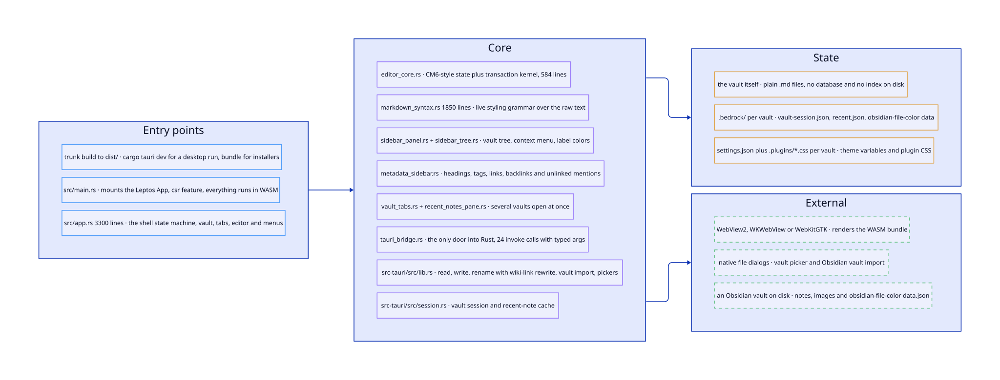

# Bedrock — how it works

A local-first markdown note app where the vault is just a folder of `.md` files: Leptos (WASM) draws everything, a small Tauri/Rust side does filesystem syscalls, and no database exists anywhere.

Read it left to right:

- **The UI is the program.** Editing rules, markdown styling, sidebar, tabs and metadata all live in the WASM bundle; the Rust side (`src-tauri/src/lib.rs`) is only a filesystem API — read, write, rename, index, pick a folder. That split is why there is no save button and no index file: the app can always rebuild itself from the directory.
- **Edits flow through one kernel.** `editor_core.rs` is deliberately CM6-shaped (state plus transactions) rather than a pile of `setText` calls, so keybindings, auto-pairing, list continuation and undo all compose through the same apply path instead of fighting each other.
- **Markdown is never rendered to display markup.** `markdown_syntax.rs` (1850 lines) stylizes the raw text in place; `pulldown-cmark` is only there for preview-style rendering. The document you edit is always the literal file, which is why an unclosed `**` cannot eat your note.
- **Metadata is an in-memory index, not storage.** Headings, tags, links, backlinks and unlinked mentions are recomputed from the vault, and `rename_note` rewrites wiki-links across the vault in Rust so a rename is one operation rather than a UI-side find-and-replace.
- **Configuration travels with the vault.** `settings.json`, `.plugins/*.css` and `.bedrock/` (session, recent notes, Obsidian file-colour data) sit beside the notes, so a vault copied to another machine keeps its themes. The plugin API is CSS variables — dropping a `.css` file in `.plugins` is the whole extension mechanism.

Diagram source: [`docs/system.d2`](docs/system.d2) · render with [`scripts/render-diagram.sh`](scripts/render-diagram.sh) (writes `docs/system.svg` and `docs/system.png`).
